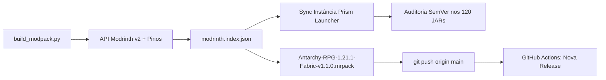

---
tags:
  - cicd
  - arquitetura
---

# 03 - Pipeline de Build e CI/CD

Relacionado: [[00-Index]] | [[01-Arquitetura-Modpack]] | [[02-Restricoes-e-Pinos]]

## Fluxo de Atualização Local



### 1. Gerar o Pacote
```powershell
python build_modpack.py
```
- Resolve todas as slugs de `MOD_SLUGS` + dependências transitivas obrigatórias.
- Respeita `PINNED_VERSIONS` e `SKIP_MODRINTH_IDS` (ver [[02-Restricoes-e-Pinos]]).
- Empacota `modrinth.index.json` + `overrides/` em `Antarchy-RPG-1.21.1-Fabric-v1.1.0.mrpack`.

### 2. Sincronizar e Auditar a Instância do Prism Launcher
Ao atualizar versões, **sempre remover JARs antigos** da pasta `mods/` da instância local antes/durante o sync para evitar JARs duplicados de versões diferentes (ex.: `antarchy-2.3.0` + `2.3.1`).

---

## Automação de Releases (`.github/workflows/release.yml`)

- **Gatilho (`on.push`):** Dispara automaticamente na branch `main` apenas quando `Antarchy-RPG-1.21.1-Fabric-v1.1.0.mrpack` (ou o próprio workflow) é modificado. Também suporta disparo manual (`workflow_dispatch`).
- **Permissão:** `contents: write` (usa o `GITHUB_TOKEN` nativo do repositório).
- **Tag gerada:** `v1.0.${{ github.run_number }}` (ex.: `v1.0.1`, `v1.0.2`).
- **URL Fixa para Download Direto:**
  `https://github.com/hannskotaro/modpack-antarchy-hannskotaro/releases/latest/download/Antarchy-RPG-1.21.1-Fabric-v1.1.0.mrpack`
  - Como toda release nova recebe a flag `--latest`, essa URL nunca muda e sempre entrega o `.mrpack` mais recente.
