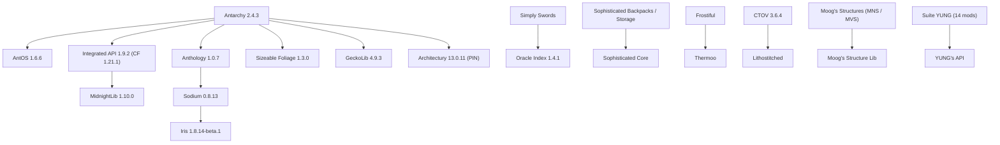

---
tags:
  - mods
  - core
---

# 06 - Catálogo e Árvore de Mods

Relacionado: [[00-Index]] | [[02-Restricoes-e-Pinos]]

## Relação de Dependências Críticas

## Categorias do Pack (121 Arquivos)

- **Núcleo Antarchy:** `antarchy`, `antos`, `anthology`, `integrated-api`, `sizeable-foliage`, `midnightlib`
- **Combate & RPG:** `better-combat`, `combat-roll`, `simply-swords`, `oracle-index`, `tieredz`, `bosses-of-mass-destruction`, `adventurez`, `artifacts`, `trinkets`, `attributefix`, `mmmmmmmmmmmm` (Target Dummy)
- **Mobs & Invasões:** `creeper-overhaul`, `guard-villagers-fabricquilt`, `illager-invasion`, `frostiful`
- **Terreno & Estruturas:** `terralith`, `tectonic`, `ct-overhaul-village`, `when-dungeons-arise`, `when-dungeons-arise-seven-seas`, `dungeons-and-taverns`, `structory`, `structory-towers`, `towns-and-towers`, `explorify`, `mns-moogs-nether-structures`, `moogs-voyager-structures`, `medieval-buildings`, `medieval-buildings-end-edition`, Suíte completa `YUNG's` (15 projetos)
- **Armazenamento, Culinária & Mineração:** `sophisticated-backpacks-unoffical-fabric-port`, `sophisticated-storage-unofficial-fabric-port`, `toms-storage`, `farmers-delight-refabricated`, `veinminer`, `veinminer-client`
- **Navegação & QoL:** `xaeros-minimap`, `xaeros-world-map`, `waystones`, `natures-compass`, `explorers-compass`, `travelers-compass`, `controlling`, `enchantment-descriptions`, `emi`, `emi-loot`, `jade`, `polymorph`, `appleskin`, `yigd`, `clumps`, `modmenu`
- **Multiplayer:** `essential`, `lootr`
- **Performance, Áudio & Visual:** `sodium`, `lithium`, `iris`, `ferrite-core`, `immediatelyfast`, `entityculling`, `modernfix`, `noisium`, `spark`, `sound-physics-remastered`, `ambientsounds`, `presence-footsteps`, `medieval-music`, `visuality`, `not-enough-animations`, `eating-animation`, `3dskinlayers`, `lambdynamiclights`, `complementary-reimagined`
